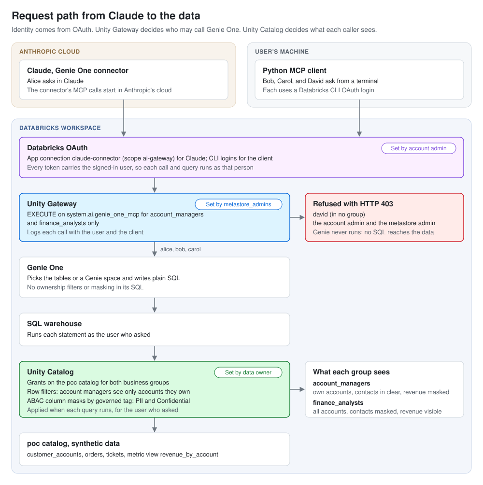
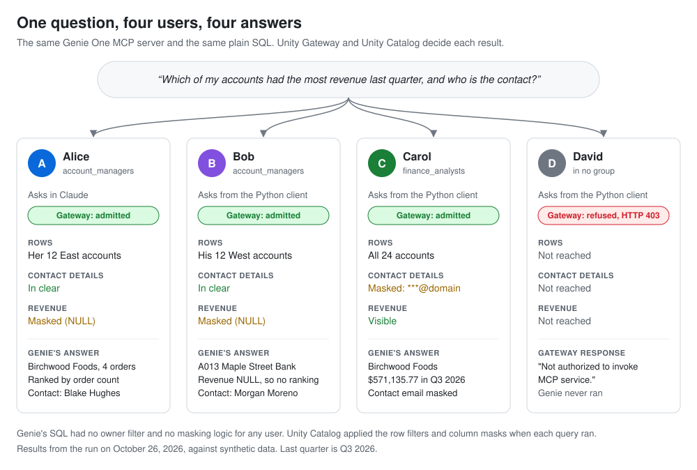
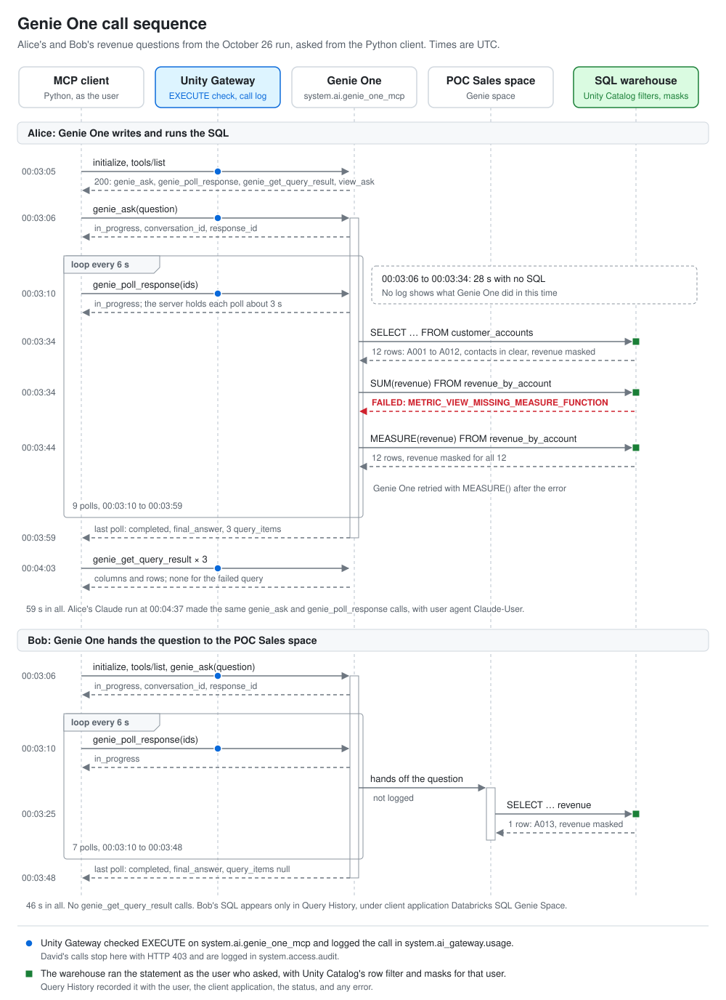

# genie-mcp-poc

Claude asks Databricks Genie One questions over MCP, and Databricks decides who may ask and what each person sees. The user's identity reaches Databricks through OAuth. Unity Gateway decides who may call Genie One. Unity Catalog row filters and column masks decide which rows and fields come back. Claude, the MCP server, and Genie hold no access rules.

Addresses use `example.com` and workspace identifiers are placeholders such as `<workspace-host>`. Substitute your own users and workspace to reproduce it.

## Components and test users

The POC runs on a Databricks trial workspace (AWS, serverless). Catalog `poc` holds synthetic sales and support data: 24 customer accounts, 120 orders, and 40 support tickets. Two Genie spaces cover sales and support, and Genie One answers across the workspace.

- **Claude** reaches Genie One through a custom connector on the Genie One MCP URL (`/ai-gateway/mcp-services/system.ai.genie_one_mcp`). The connector signs in with a Databricks OAuth app connection, as the user.
- **A Python MCP client** (`client/genie_client.py`) calls the same MCP server as any Databricks CLI profile.
- **Four users ask the questions.** Alice and Bob are account managers who each own 12 accounts. Carol is a finance analyst who sees every account. David is in neither group. Alice asks from Claude; the others use the client.
- **Two admins set the rules.** The account admin builds the workspace and appoints the metastore admin group. Frank, its only member, decides who may call Genie One. [Users and groups](#users-and-groups) has the details.



## Identity, access, and data checks

1. **Identity.** Each question runs in Databricks as the person who asked, from Claude and from the client.
2. **Who may call Genie One.** Unity Gateway admits the two business groups and refuses everyone else before Genie runs.
3. **What each user sees.** Unity Catalog row filters and ABAC column masks shape each answer. Genie's SQL holds no ownership or masking logic.
4. **Attribution.** The gateway log, the audit log, and query history name the user behind each call.

## Results from the October 26, 2026 run

All four checks pass.

- **Identity.** Every statement Genie ran shows the asking user in query history. Alice's Claude calls reach the gateway as `alice@example.com` with user agent `Claude-User`.
- **Who may call Genie One.** Alice, Bob, and Carol are admitted. David, the account admin, and the metastore admin get HTTP 403 on every MCP request, starting with `initialize`.
- **What each user sees.** One question, four different answers, shown below. None of the 26 statements Genie ran contains an owner filter, `current_user()`, or a masking `CASE`.
- **Attribution.** `system.ai_gateway.usage` names the caller and client for each admitted tool call. `system.access.audit` records each refused call with the caller and the error. The Query History API names the user for each statement.



## Live tests

`tests/` runs the four checks against the live workspace as each user and fails on any mismatch. Last run: 70 passed in 2 minutes 20 seconds, on 2026-10-27.

```
uv run --with-requirements tests/requirements.txt pytest tests
uv run --with-requirements tests/requirements.txt pytest tests -m "not genie and not logs"   # 42 fast tests
```

| File | What it checks |
| --- | --- |
| `test_identity.py` | Each CLI profile signs in as its user, in the expected groups. The metastore admin is `metastore_admins`. Only the account admin is a workspace admin |
| `test_governance.py` | The 16 checks in `sql/verify/<user>.sql` pass for Alice, Bob, and Carol. The account admin sees 0 accounts. No reader can query the ownership lookup. David and Frank cannot read `poc` |
| `test_gateway.py` | Only the two business groups hold EXECUTE on Genie One. Alice, Bob, and Carol get through `initialize` and `tools/list`. David, the account admin, and Frank get HTTP 403 and JSON-RPC `-32007` on every method, and the Python client reports the refusal |
| `test_genie_one.py` | Genie One answers the Sales and cross-space questions for the three users. Every statement ran as the asker and holds no access logic. Each statement, run again as the asker, returns only that user's accounts, with contacts and revenue masked per group |
| `test_logs.py` | The gateway log names Alice for Claude calls and each client user. The audit log records each refusal and names Frank for the grant change. No refused user made a successful call after it |

- All six CLI logins must be fresh. A stale login fails the test with the `databricks auth login` command to run.
- Claude can't be driven from a test. `test_logs.py` checks the record that a manual Claude run (`demo/script.md`, step 1) leaves in the gateway log.
- The system tables lag the calls by 20 to 60 minutes, so `test_logs.py` looks back over the last 7 days (`GENIE_POC_LOG_DAYS`) instead of at the current run.
- The Query History API shows a user their own Genie statements as `<REDACTED>`, so the tests read them as admin. `test_statement_text_is_readable` fails if the text is missing.
- Refused calls appear in `system.access.audit` (`mcpService`, `mcpCall`, status 403). `system.ai_gateway.usage` records admitted calls only.

The sections below hold the workspace details, the governance rules, the evidence, and the setup steps.

## Workspace

| Item | Value |
| --- | --- |
| Workspace URL | https://<workspace-host> |
| Workspace ID | <workspace-id> |
| Setup | Databricks 14-day trial, express setup (AWS, serverless) |
| Metastore ID | <metastore-id> |
| SQL warehouse | poc-warehouse, id <warehouse-id> (serverless, 2X-Small, auto-stop 10 min) |
| Managed MCP | On. Unity Gateway > MCPs lists `genie_one_mcp` and each Genie space |
| System schemas | `system.access` and `system.query` are on by default (state MANAGED) |
| Governed tags | `classification` (PII, Confidential), `row_owner` (account_id) |
| Row filters | `poc.governance.account_owner_filter`, `poc.governance.child_of_owned_account` (table-level) |
| Column mask policies | `pii_owner_only`, `confidential_finance_only` (ABAC, on catalog `poc`) |
| Sales space (POC Sales) | `01f1cf5620d416d7aa946c544e305338`, https://<workspace-host>/genie/rooms/01f1cf5620d416d7aa946c544e305338 |
| Support space (POC Support) | `01f1cf56216412c4980510a065fa8e7c`, https://<workspace-host>/genie/rooms/01f1cf56216412c4980510a065fa8e7c |
| Sales MCP URL | https://<workspace-host>/api/2.0/mcp/genie/01f1cf5620d416d7aa946c544e305338 |
| Support MCP URL | https://<workspace-host>/api/2.0/mcp/genie/01f1cf56216412c4980510a065fa8e7c |
| Genie One MCP URL | https://<workspace-host>/ai-gateway/mcp-services/system.ai.genie_one_mcp |
| OAuth app (Genie One) | `claude-connector`, confidential client, client ID `<claude-connector-client-id>` (secret kept in a password manager, never in the repo) |
| OAuth app (Genie Sales) | `claude-genie-sales`, public client (no secret), client ID `<claude-genie-sales-client-id>` |

## Users and groups

| User | Group | Owns | CLI profile |
| --- | --- | --- | --- |
| admin@example.com | admins | Nothing; account admin and workspace admin | `admin` |
| alice@example.com | account_managers | 12 East accounts | `alice` |
| bob@example.com | account_managers | 12 West accounts | `bob` |
| carol@example.com | finance_analysts | Nothing; sees all rows | `carol` |
| david@example.com | none | Nothing; no access to `poc` or Genie One | `david` |
| frank@example.com | metastore_admins | Nothing; metastore admin (through the group) | `frank` |

All three groups are account-level groups. Unity Catalog grants and `is_account_group_member()` need account-level groups.

Admin roles are split. The account admin (`admin@example.com`) manages identities and workspaces and decides who is metastore admin. The metastore admin is the group `metastore_admins`, whose only member is Frank; he holds no account or workspace admin role. Frank runs `sql/07_gateway.sql`, which decides who may call Genie One. The `poc` objects are still owned by `admin@example.com`, who created them.

Each test user needs an address that receives Databricks sign-in codes; a forwarding alias works. Gmail plus-addresses do not: Databricks treats `name+alice@gmail.com` as the same identity as `name+admin@gmail.com` and rejects the new user with a 409.

## Row counts

Loaded by `seed/load_seed.py`. Counted as `carol`, who sees every row; `admin` counts 0 in the filtered tables once the row filters are on.

| Table | Rows | alice | bob |
| --- | --- | --- | --- |
| poc.sales.customer_accounts | 24 (12 East, 12 West) | 12 | 12 |
| poc.sales.orders | 120 (Q4 2025 to Q3 2026; every account has a Q3 2026 order) | 60 | 60 |
| poc.support.tickets | 40 (open high-severity tickets on A002, A005, A014, A019) | 24 | 16 |
| poc.governance.account_owners | 24 (ownership lookup; no reader grants) | no access | no access |

The data is fixed rather than relative to today, so "last quarter" means Q3 2026 for a demo run in Q4 2026.

## Governance

| Column | Tag | alice, bob (owners) | carol (finance_analysts) |
| --- | --- | --- | --- |
| customer_accounts rows | row filter on owner_email | own accounts only | all |
| orders, tickets rows | row filter on account_id | rows of own accounts | all |
| contact_email, tickets.reporter_email | classification = PII | clear | `***@domain` |
| contact_phone | classification = PII | clear | `***` |
| annual_revenue, orders.amount | classification = Confidential | NULL | clear |

Row filters are table-level (`SET ROW FILTER`). Column masks are ABAC policies on catalog `poc` that find columns by governed tag, so tagging a new column masks it with no policy change. The PII mask decides ownership from the row's `account_id`, which the policy finds by the `row_owner` tag.

The filter on orders and tickets and the PII mask read ownership from `poc.governance.account_owners`. Databricks rejects a filter or mask that reads a table with its own filter or mask (`UNSUPPORTED_NESTED_ROW_OR_COLUMN_ACCESS_POLICY`), so they cannot read `customer_accounts`. Readers have no SELECT on `account_owners`; the functions run with their owner's privileges.

`sql/verify/<user>.sql` runs 16 checks as that user, including two join checks (no visible order or ticket belongs to a hidden account). Result on 2026-10-23: 16 of 16 pass for alice, bob, and carol.

## Genie spaces

`genie/create_spaces.py` builds each space from `genie/<name>_space.json` through the Genie API (`POST /api/2.0/genie/spaces`, `PATCH` on rerun), grants CAN RUN to both groups, and writes `genie/spaces.json`.

| Space | Data | Example question |
| --- | --- | --- |
| POC Sales | customer_accounts, orders, metric view revenue_by_account | What was revenue by account last quarter? |
| POC Support | customer_accounts, tickets | Which of my accounts have open high-severity tickets? |

`poc.sales.revenue_by_account` (`sql/06_metric_view.sql`) is a metric view over orders joined to customer_accounts, with measures `revenue` (sum of amount) and `order_count`. The base tables' filters and masks apply to the reader.

The space instructions tell Genie not to add ownership predicates or masking: "my accounts" means every row the user can see, because the row filters already limit it. The `customer_accounts` table comment says the same, which Genie One also reads. An earlier version told Genie to filter on `owner_email = current_user()`; the answers were the same, but the SQL carried ownership logic, which the acceptance checklist rules out.

Check on 2026-10-23, as alice through the Genie conversation API and the MCP client:

- POC Sales, "Which of my accounts had the most revenue last quarter, and who is the contact?": 12 East accounts with contacts in clear; revenue NULL, reported as restricted.
- POC Support, "Which of my accounts have open high-severity tickets?": A002 Birchwood Foods and A005 Evergreen Clinics, one ticket each.

## Unity Gateway access to Genie One

`sql/07_gateway.sql`, run as Frank, gives EXECUTE on `system.ai.genie_one_mcp` to `account_managers` and `finance_analysts` and removes the default EXECUTE on `system.ai` from `account users`. Grants after the run:

| Securable | Principal | Privilege |
| --- | --- | --- |
| Schema `system.ai` | metastore_admins | MANAGE |
| Schema `system.ai` | account users | USE SCHEMA, SELECT, READ VOLUME (EXECUTE removed) |
| MCP service `system.ai.genie_one_mcp` | account_managers, finance_analysts | EXECUTE |

The metastore admin started as a principal the express trial created (`<trial-principal-id>`), which is not a user, service principal, or group in the account. MANAGE on `system.ai` needs the metastore admin, so the account admin made `metastore_admins` the metastore admin in the account console (Catalog > metastore > Admin & Sharing). The trial principal cannot be picked again.

Check on 2026-10-27 00:05 UTC, raw MCP requests to the Genie One URL (`demo/evidence/gateway_refusals.txt` has the request ids):

| User | Result |
| --- | --- |
| alice (Claude and client), bob, carol | Allowed; answers with the usual filters and masks |
| david | HTTP 403 on `initialize`, `tools/list`, and `tools/call`: JSON-RPC `-32007` "Not authorized to invoke MCP service." |
| admin@example.com (account admin) | Same 403 |
| frank (metastore admin) | 403: "User does not have permission to use mcp service 'system.ai.genie_one_mcp'"; MANAGE lets him see the service but not call it |

Before the change, David reached Genie One and got no data: Genie One found no account tables, because Unity Catalog gives him no access to `poc` (`demo/evidence/20261026-193857_david_genie-one.json`).

## Claude connectors

The OAuth apps are custom app connections in the account console (Settings > App connections > Custom apps):

| Setting | `claude-connector` | `claude-genie-sales` |
| --- | --- | --- |
| Client ID | `<claude-connector-client-id>` | `<claude-genie-sales-client-id>` |
| Redirect URLs | `https://claude.ai/api/mcp/auth_callback`, `https://claude.com/api/mcp/auth_callback` | same |
| Scopes | `ai-gateway` (required for `/ai-gateway/mcp-services/...` URLs) | `genie`, `sql`, `openid`, `email`, `profile`, `offline_access` |
| Client secret | Generated; entered only in Claude's connector dialog | None (public client) |
| Single-use refresh tokens | Off | Off |

Claude custom connectors (Customize > Connectors > Add > Add custom connector, then "Use your own OAuth client"):

| Connector | URL | OAuth app | Status |
| --- | --- | --- | --- |
| Genie One | `https://<workspace>/ai-gateway/mcp-services/system.ai.genie_one_mcp` | `claude-connector` | Connected as alice@example.com |
| Genie Sales | `https://<workspace-host>/api/2.0/mcp/genie/01f1cf5620d416d7aa946c544e305338` | `claude-genie-sales` | Added; sign-in fails (below) |

Connect from a private window: the main browser is signed in to Databricks as admin, and the connector sign-in would otherwise authorize as admin. In the chat, turn off other connectors and skills so Claude calls Genie One.

A single Genie space is only served on the workspace route `/api/2.0/mcp/genie/<space_id>` (scope `genie`). The `/ai-gateway/mcp-services/` route accepts only `system.ai.*` services and rejects `genie-space:<id>`.

### Genie Sales connector sign-in fails in Claude

Clicking Connect on the Genie Sales connector sends the browser to `https://<workspace>/authorize` with no scope, and Databricks answers 404. Databricks' sign-in page is `/oidc/v1/authorize`. Claude uses `/authorize` when it cannot read the server's OAuth discovery metadata. Checks on 2026-10-26:

- The same client ID on the Genie One URL goes to `/oidc/v1/authorize` with `scope=ai-gateway offline_access`. The app connection and the "Use your own OAuth client" setting work.
- The legacy all-spaces URL `/api/2.0/mcp/genie` fails the same way, so every `/api/2.0/mcp/...` URL is affected.
- Databricks serves the protected-resource metadata for the full path (`/.well-known/oauth-protected-resource/api/2.0/mcp/genie/<space_id>` returns 200 with `authorization_servers: [<workspace>/oidc]`), but every shorter `/api/...` prefix returns 404. Under `/ai-gateway`, even the bare prefix returns metadata. Both routes send the same `401` and `WWW-Authenticate: Bearer realm="DatabricksRealm"`, with no `resource_metadata` and no CORS headers.

Claude appears not to look up the full-path metadata. Nothing on the Databricks side changes this, so the demo runs on Genie One for all three users. The per-space route still works from the Python client (`--server sales`).

Check on 2026-10-23: Alice asked Genie One in Claude "how many accounts do I have?" and got "You have 12 accounts assigned to you as account manager", citing `poc.sales.customer_accounts` and the owner_email definition from the table comment. No Genie space existed yet; Genie One found the table through Unity Catalog.

Check on 2026-10-26, Alice's demo questions in Claude through the Genie One connector:

| Question | Claude tool | Result |
| --- | --- | --- |
| Sales question | `view_ask` (Claude's choice) | 12 East accounts; revenue masked, so Genie ranked by order count: Birchwood Foods, 4 orders, contact Blake Hughes in clear |
| Cross-space question | `genie_ask`, `genie_poll_response` (named in the prompt) | A002 and A005, 7 Q3 2026 orders, amounts "null (masked)"; Claude summarized the answer itself |

`view_ask` renders Genie's steps, result tables, and answer in a panel inside the chat, but Claude's own reply only says "Asking Genie now", and the panel shows raw `:citation[...]` and `:embedTable[...]` markers. Naming `genie_ask` in the prompt makes Claude read the answer and summarize it. Screenshots: `demo/evidence/alice_claude_genie_one_*.jpg`.

## Python MCP client

`client/genie_client.py` asks a Genie MCP server a question as any CLI profile and prints the answer, the SQL Genie ran, and the rows. `--json` also writes the result to `demo/evidence/`.

```
uv run client/genie_client.py --profile bob "How many accounts do I have?"                       # Genie One
uv run client/genie_client.py --profile carol --server sales "What was revenue by account last quarter?"
uv run client/genie_client.py --profile alice --server support --json "Which of my accounts have open high-severity tickets?"
```

| Server | URL | Tools the client calls |
| --- | --- | --- |
| `genie-one` (default) | `/ai-gateway/mcp-services/system.ai.genie_one_mcp` | `genie_ask`, then `genie_poll_response` until done, then `genie_get_query_result` per query |
| `sales`, `support` | `/api/2.0/mcp/genie/<space_id>` | `query_space_<id>`, then `poll_response_<id>` if not complete |

Authentication is the profile's OAuth login through `databricks_mcp.oauth_provider.DatabricksOAuthClientProvider`. The client opens its own MCP session because `DatabricksMCPClient` uses httpx's 5 second default timeout, and the space tools hold the request open until Genie answers (10 to 25 seconds here). Error messages:

- An expired or invalid login prints the `databricks auth login` command for that profile.
- A user without CAN RUN on a space gets "needs CAN RUN on the space" (tested by removing finance_analysts from the Support space, then restoring it).

Check on 2026-10-23, "List all customer accounts with region, contact email, contact phone, and annual revenue" on the Sales space (Carol's run predates the space instruction fix in Phase 6, so only Bob's rerun is in `demo/evidence/`):

| User | Rows | Regions | Contact email and phone | annual_revenue |
| --- | --- | --- | --- | --- |
| bob | 12 | West | clear | NULL ("restricted for this user") |
| carol | 24 | East and West | `***@domain`, `***` | values |

Bob asked for all accounts and got his 12: the row filter decides, not the question.

Genie One does not see a space's instructions when it queries tables directly. Asked the cross-space question, it told Alice revenue was "genuinely null (not reported)" for her accounts, though the value is masked. The rows were right; only the explanation was wrong.

Genie One sometimes hands a question to a Genie space instead of querying the tables itself. On 2026-10-26 it sent Bob's and Carol's Sales questions to the POC Sales space (query history shows client application `Databricks SQL Genie Space` and the space id). In that case `genie_poll_response` returns `query_items: null`, so the client's JSON has no SQL. `demo/collect_evidence.py` reads the SQL from the Query History API instead.

## Genie One call sequence

Genie One is an agent: it picks tables or a Genie space, writes SQL, runs it as the user, and tries again when a statement fails. The diagram follows Alice's and Bob's revenue questions from the October 26 run. It is built from three records: the gateway log (`system.ai_gateway.usage`), the Query History API, and the responses the client saved in `demo/evidence/`.



- Alice's question: Genie One started two statements at 00:03:34 UTC. The `SUM(revenue)` statement on the metric view failed with `METRIC_VIEW_MISSING_MEASURE_FUNCTION`, and Genie One ran it again with `MEASURE()` 10 seconds later. The final response listed all three statements, including the failed one.
- Bob's question: Genie One handed it to the POC Sales space. The space's statement ran as bob, and the final response had no query items.
- Genie One worked for 28 seconds on Alice's question before its first statement. No log shows that work: the prompts, the model, and the choice between tables and a space are not recorded.
- Genie One also draws on the user's earlier conversations. Alice's `genie_ask` carried no `conversation_id`, and the answer began "I confirmed this matches what I found in our conversation an hour ago."

## Demo and evidence

`demo/script.md` is the seven-step storyline, all on Genie One: the same Sales question from Alice (Claude), Bob, and Carol (client); the generated SQL; the gateway log; the cross-space question; and the evidence. `demo/collect_evidence.py` writes the evidence after a run:

| File | Contents |
| --- | --- |
| `demo/evidence/*.json` | each client run: user, question, answer, SQL (when Genie One returns it), rows |
| `demo/evidence/generated_sql.md` | every statement Genie ran for the three users, from the Query History API, with a check for ownership or masking logic |
| `demo/evidence/query_history.csv` | the same statements as CSV |
| `demo/evidence/gateway_usage.csv` | `system.ai_gateway.usage` rows for the three users' Genie One tool calls |
| `demo/evidence/audit.csv` | `system.access.audit` rows from `managedMcp`, `mcpService`, `aibiGenie`, `genieChat` for the three users |

In the gateway log and the audit log, `user_agent` tells the clients apart: `Claude-User` for the Claude connector, `python-httpx2` for the Python client. The gateway log names the caller (`requester`) and the tool (`mcp_metadata.tool_name`). Both tables lagged 20 to 30 minutes on 2026-10-26. `system.query.history` stopped at 2026-10-24 03:24 UTC and was still there on 2026-10-26, which is why the SQL comes from the Query History API.

Evidence in the repo starts with the rehearsal on 2026-10-24 (client runs from 03:07 UTC), after the space instructions were fixed. Earlier statements used the old instructions, which told Genie to filter on `owner_email = current_user()`.

| Run | Result |
| --- | --- |
| Sales question, alice (client) | 12 East accounts, contacts in clear, revenue NULL |
| Sales question, bob (client) | 12 West accounts, contacts in clear, revenue NULL |
| Sales question, carol (client) | top account A002 Birchwood Foods, $571,135.77; contact `***@birchwoodfoods.example`, phone `***` |
| Cross-space, alice (Genie One, client) | A002 and A005 with 7 Q3 2026 orders, amounts NULL |
| Cross-space, bob (Genie One, client) | A014 and A019 with their tickets (reporter emails in clear) and Q3 orders, amounts NULL |
| Cross-space, carol (Genie One, client) | A002, A005, A014, A019 with annual revenue and order amounts |
| All accounts, bob (client) | 12 West accounts only |
| Sales question, alice (Claude, Genie One), 2026-10-26 | 12 East accounts, contacts in clear, revenue masked; top by orders Birchwood Foods |
| Sales question, bob (Genie One, client), 2026-10-26 | A013 Maple Street Bank, contact in clear, revenue NULL |
| Sales question, carol (Genie One, client), 2026-10-26 | top account A002 Birchwood Foods, $571,135.77; contact emails `***@<domain>` |
| Cross-space, alice (Claude, Genie One), 2026-10-26 | A002 and A005 with 7 Q3 2026 orders, amounts NULL |

All 20 statements Genie ran for the three users since 2026-10-24 03:07 UTC are free of ownership and masking logic, and the Query History API attributes each one to the asker.

Bob's 2026-10-26 answer said the ranking "is still reliable" with revenue masked. It isn't: every revenue value is NULL, so the sort fell back to account id. The rows are right; Genie's explanation is wrong.

## Acceptance checklist

| Item | Status |
| --- | --- |
| Alice, Bob, and Carol each get the expected rows and masking for the Sales question, Alice through Claude and the others through the client | Pass on Genie One, 2026-10-26 |
| Generated SQL for all three runs contains no ownership or masking logic | Pass (`demo/evidence/generated_sql.md`, from the Query History API) |
| Audit or query history attributes each run to the right user | Pass: Query History API `user_name`; gateway `requester` and audit events with `user_agent` Claude-User for Alice's connector |
| Genie One answers the cross-space question for Alice in Claude and for Bob in the client, with the same governance | Pass: Alice in Claude 2026-10-26, Bob in the client 2026-10-24 |
| Unity Gateway lets only the two business groups call Genie One | Pass, 2026-10-27: alice, bob, carol allowed; david, the account admin, and the metastore admin refused with HTTP 403 |
| A live test suite checks identity, governance, the gateway, Genie One, and the logs as each user | Pass, 2026-10-27: 70 tests (`tests/`) |
| README reproduces the setup from a fresh trial in under two hours | Written; not yet timed on a fresh trial |

## Repo layout

```
sql/01_schema.sql        catalog poc, schemas sales, support, governance; tables with comments
seed/generate_seed.py    writes seed/*.csv deterministically (fixed random seed)
seed/*.csv               the generated seed data
seed/load_seed.py        truncates and reloads the tables through the Statement Execution API
tools/run_sql.py         runs SQL files or inline SQL on poc-warehouse as any CLI profile
tools/dbsql.py           shared helpers for the two scripts above
sql/02_governed_tags.sql account-level governed tags (run once)
sql/02_tags.sql          column tags
sql/03_row_filters.sql   row filter functions, applied with SET ROW FILTER
sql/04_abac.sql          mask functions and the ABAC column mask policies
sql/05_grants.sql        catalog, schema, table, and function grants for both groups
sql/verify/<user>.sql    governance checks, run as alice, bob, and carol
sql/06_metric_view.sql   metric view revenue_by_account
sql/07_gateway.sql       Unity Gateway: EXECUTE on genie_one_mcp for the two groups only (run as frank)
genie/*_space.json       readable Genie space definitions (tables, instructions, example SQL)
genie/create_spaces.py   creates or updates the spaces through the Genie API
genie/spaces.json        space ids and URLs written by create_spaces.py
client/genie_client.py   MCP client: ask Genie One or a space as a CLI profile
client/requirements.txt  the client's dependencies, for pip users
demo/script.md           the demo storyline with exact questions and expected answers
demo/collect_evidence.py writes generated_sql.md, query_history.csv, gateway_usage.csv, audit.csv
demo/evidence/           client results (*.json) and the files above
docs/images/             request-path.svg, who-sees-what.svg, and genie-one-sequence.svg, the diagrams in this README
tests/                   live pytest suite: identity, governance, gateway, Genie One, logs
```

## Setup from a fresh trial

Prerequisites: Databricks CLI (`databricks-cli` via mise or Homebrew) and `uv`. No tokens or passwords are stored in this repo. Each CLI profile holds an OAuth U2M login in `~/.databrickscfg`.

1. Start a Databricks trial with express setup. Create the three users and the two groups in Settings > Identity and access. Each user signs in once.
2. Log in the four CLI profiles. `BROWSER=none` makes the CLI print the sign-in URL instead of opening the default browser, where the admin is already signed in. Open the admin URL in the normal browser and each user's URL in a fresh private window signed in as that user.

   ```
   HOST=https://<workspace-host>
   BROWSER=none databricks auth login --host $HOST --profile admin
   BROWSER=none databricks auth login --host $HOST --profile alice
   BROWSER=none databricks auth login --host $HOST --profile bob
   BROWSER=none databricks auth login --host $HOST --profile carol
   databricks current-user me --profile alice   # confirm each identity
   ```

3. Create the warehouse and grant it to both groups:

   ```
   databricks warehouses create --profile admin --json '{"name":"poc-warehouse","cluster_size":"2X-Small","min_num_clusters":1,"max_num_clusters":1,"auto_stop_mins":10,"enable_serverless_compute":true,"warehouse_type":"PRO"}'
   databricks permissions update warehouses <warehouse-id> --profile admin --json '{"access_control_list":[{"group_name":"account_managers","permission_level":"CAN_USE"},{"group_name":"finance_analysts","permission_level":"CAN_USE"},{"group_name":"metastore_admins","permission_level":"CAN_USE"}]}'
   ```

4. Create the schema and load the data:

   ```
   uv run tools/run_sql.py --profile admin sql/01_schema.sql
   python3 seed/generate_seed.py
   uv run seed/load_seed.py
   ```

5. Apply governance and check it as each user:

   ```
   uv run tools/run_sql.py --profile admin sql/02_governed_tags.sql   # once per account
   uv run tools/run_sql.py --profile admin sql/02_tags.sql sql/03_row_filters.sql sql/04_abac.sql sql/05_grants.sql
   uv run tools/run_sql.py --profile alice sql/verify/alice.sql
   uv run tools/run_sql.py --profile bob   sql/verify/bob.sql
   uv run tools/run_sql.py --profile carol sql/verify/carol.sql
   ```

6. Create the metric view and the Genie spaces:

   ```
   uv run tools/run_sql.py --profile admin sql/06_metric_view.sql
   uv run genie/create_spaces.py
   ```

7. Limit Genie One to the two business groups. This changes grants on `system.ai`, which needs the metastore admin:
   - Add `david@example.com` (no groups) and `frank@example.com` as workspace users, as in step 1, and log in their CLI profiles as in step 2.
   - In the account console, create the account group `metastore_admins` with Frank as its only member. Then open Catalog > the metastore > Admin & Sharing, click the pencil, set Metastore Admin to `metastore_admins`, and save.
   - Grant `metastore_admins` CAN_USE on the warehouse (the step 3 command includes it), then run the grants as Frank:

   ```
   uv run tools/run_sql.py --profile frank sql/07_gateway.sql
   ```

8. Create the OAuth app connection and the Claude connectors (see Claude connectors), then follow `demo/script.md`.

## Notes

- CLI 1.22 has no `databricks sql execute` command, so `tools/run_sql.py` runs SQL through the Statement Execution API.
- The Python SDK's CLI lookup resolves symlinks, which breaks the mise shim. `tools/dbsql.py` sets `DATABRICKS_CLI_PATH` to the `databricks` found on `PATH` to avoid it.
- The Databricks console shows an "Automated browser control detected" banner and does not support browser automation. Console steps are done by hand.
- `CREATE GOVERNED TAG` has no `IF NOT EXISTS` or `OR REPLACE`, and `DROP POLICY` has no `IF EXISTS`. Change tag values with `ALTER GOVERNED TAG ... SET VALUES`.
- A column mask policy with two `MATCH COLUMNS` aliases fails with `UC_ABAC_UNMATCHED_USING_ALIAS` on any table where only one alias matches. Every table with a PII column therefore tags its account_id column `row_owner`.
- A policy cannot be dropped while it references a tag value that was removed from the governed tag (`UC_ABAC_INVALID_TAG_POLICY_VALUE`), and the error blocks every table in the catalog. Drop the policy before removing the value.

## Phase status

| Phase | Status |
| --- | --- |
| 0. Trial and workspace | Done |
| 1. Repo, CLI profiles, seed data | Done |
| 2. Governance | Done |
| 3. Genie spaces | Done (API check as alice); UI check as alice pending |
| 4. OAuth app and Claude connectors | Done for Genie One (Alice's demo questions pass in Claude, 2026-10-26). Genie Sales connector added but blocked by Claude's sign-in discovery on `/api/2.0/mcp/...` URLs |
| 5. Python MCP client | Done |
| 6. Demo run and evidence | Done on Genie One, 2026-10-26; Unity Gateway access control added 2026-10-27 |
